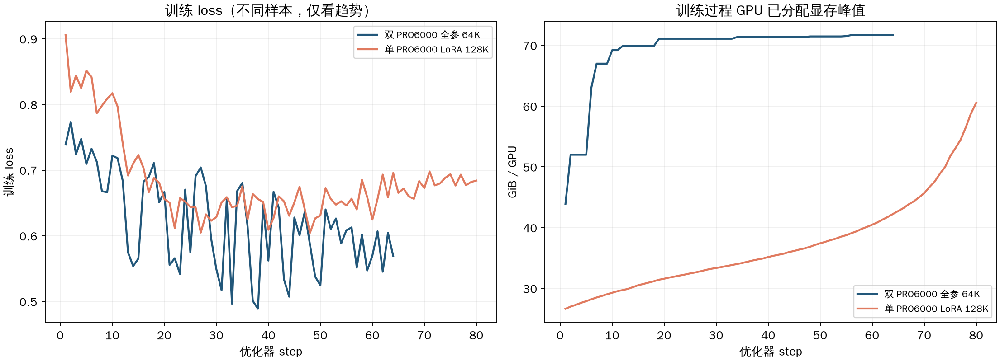
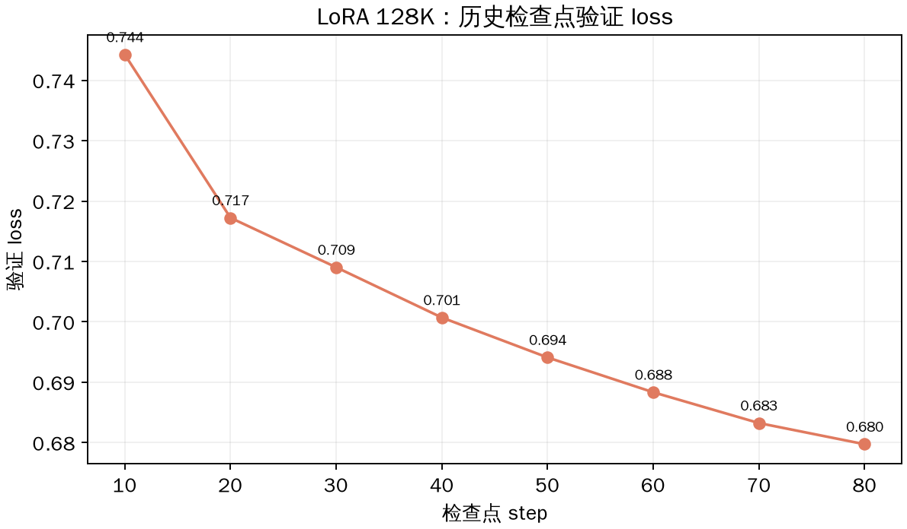
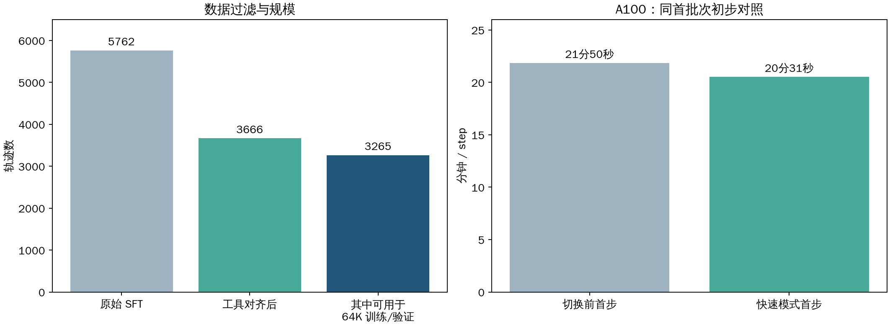
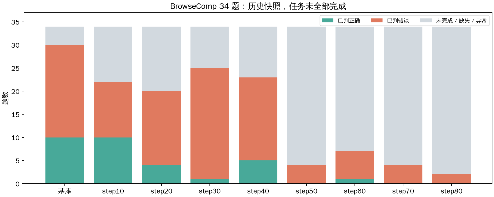

# Glasseek SFT 实验进展

> 数据快照：2026-11-05 21:02（北京时间）。本文为阶段性记录，训练和评估结果可能继续变化。

## 一句话结论

双卡 PRO 6000 的 **9B 全参数 64K SFT** 已进入后半程；此前单卡 **LoRA 128K** 的验证 loss 从 step 10 的 **0.744** 降至 step 80 的 **0.680**。两者使用的数据范围和课程顺序不同，当前不能仅凭训练 loss 判定哪种方案的最终搜索能力更强。

## 1. 实验设置

| 实验 | 硬件 / 训练方式 | 数据与训练设置 | 当前状态 |
|---|---|---|---|
| LoRA 128K | 单张 PRO 6000，LoRA r=16、α=32 | 原始轨迹筛到 128K；训练 5,480、验证 269；global batch 64；按长度排序 | 主比较截取 step 1–80；已补算 step 10–80 验证 loss |
| 全参数 64K | 双 PRO 6000、FSDP2、SP=1 | 原始轨迹筛到 64K；训练 4,831、验证 241；global batch 64；按助手回合数排序；1 epoch | 快照时约 step **64/76**；每 10 步保存，未开启定期验证 |
| 对齐数据 LoRA 64K | 单张 A100 80GB、LoRA r=16、α=32；快速卷积路径 | 训练 3,115、验证 150；global batch 64；按长度排序；3 epochs | 快照时 step **6/48（第 1 epoch）**；每 10 步保存，每 epoch 验证 |

三项均基于 Qwen3.5-9B。A100 使用的是**工具和 system prompt 对齐后的新数据**；前两项使用此前的原始轨迹筛选版本。

## 2. 训练与验证结果

- step 40 的训练 loss：全参数 64K **0.562**，LoRA 128K **0.609**；但批次和课程顺序不同，只能作训练过程参考。
- step 42 的单 GPU 已分配显存峰值：全参数约 **71.4 GiB**，LoRA 约 **35.5 GiB**。两卡全参数使用 FSDP 分片；不能把单卡峰值直接当作总显存。
- step 31–40 的耗时中位数：全参数双卡约 **6.0 分钟/步**，单卡 LoRA 约 **10.1 分钟/步**；样本长度不同，不能视为严格吞吐基准。

LoRA 的验证 loss 在 step 10–80 持续下降；全参数实验目前**缺少相同验证集的验证 loss**，因此还无法做公平的泛化对比。

## 3. 数据对齐与快速路径

- 5,762 条原始轨迹中，排除调用评估工具集之外的轨迹及参数不兼容轨迹后，保留 **3,666 条**；其中 64K 训练/验证为 **3,115 / 150**。
- 工具定义和通用 system 指导统一到评估版本；保留轨迹的 system prompt 固定为 **4,474 token**。运行时用户消息、工具返回及其他上下文仍可能不同，不能说完整训推输入一致。
- A100 上补齐 `causal-conv1d` 后，同一首批次从 **21分50秒** 降到 **20分31秒**，吞吐约提升 **6.5%**。这只是单批初步比较；快速算子的小规模 GPU 前向/反向已通过参考值比较，尚未用完整 64K 轨迹验证显存。

## 4. BrowseComp 重新评估快照

各组预定同一批 34 题，但当前快照存在未完成、缺失或异常记录，各组已判题数不同。图中展示**计数，不作为最终准确率排名**；强制终止和服务异常不当作正常答错。需要统一有效题集后再比较正确率、工具调用、耗时与轨迹质量。

## 5. 主要问题与下一步

1. **补公平验证**：使用同一验证集分别评估全参数和 LoRA 检查点，比较验证 loss 与搜索任务正确率。
2. **补长序列实测**：在 A100 上验证 64K 最长轨迹的前向、反向及显存峰值；当前长度上限不等于 OOM 已排除。
3. **验证快速路径收益**：用相同批次重复测量 token/s、step 耗时和显存，区分首次编译与稳定吞吐。
4. **完成评估并排查工具**：对齐题目、工具 schema、prompt 和并发条件；分别统计判题失败、工具错误和有效样本数。
5. **训练管理**：持续监控磁盘、保存和恢复状态；依据统一验证结果决定是否继续训练，而不是仅根据训练 loss 选模型。

## 数据来源

- 训练曲线：本机 TensorBoard 事件文件；[合并对比页面](https://u658218-tujr-2a65f9fa.westd.seetacloud.com:8443/)。LoRA 曲线使用断点修正后的累计 token，截取到 step 80。
- A100：`lifei:/mnt/second/moxu/logs/lifei-sft-64k-fastpath.log`；快照见同目录 `a100_metrics_snapshot.txt`。
- 评估：Quest 轨迹查看器保存的各 checkpoint 数据快照。制图脚本为同目录 `make_charts.py`。
