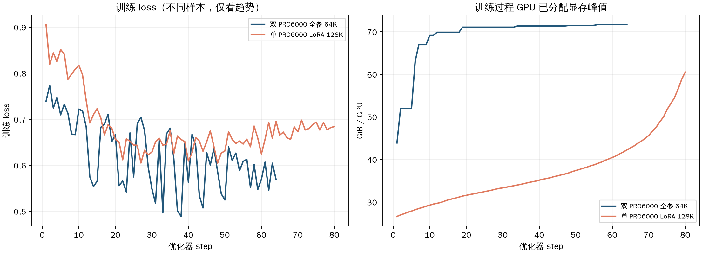
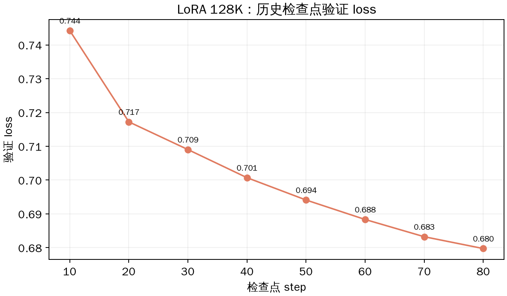
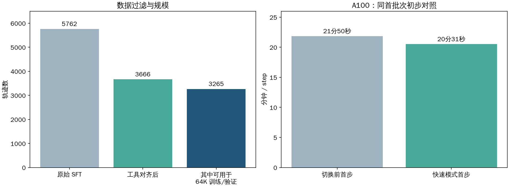
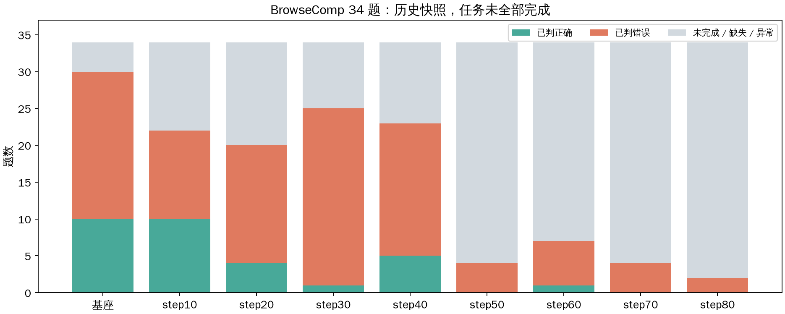

# 从 QUEST 到 Glasseek：让模型学会查资料、做研究

> 面向非专业听众的阶段性汇报｜2026 年 11 月 5 日 21:10（北京时间）  
> 图表为 21:02 左右的历史快照，训练仍在继续。

## 我们的任务：训练一个会自己查资料的助手

普通聊天模型回答问题时，容易只凭已有记忆。我们的目标更进一步：给它一个复杂问题后，让它**自己拆解问题、搜索网页、阅读资料、核对证据，最后给出有依据的答案**。

例如，问题可能要求找一家同时满足成立时间、签约日期和业务范围的公司。模型需要多次搜索，逐条排除不符合条件的候选，不能只看一次搜索结果就下结论。这样一整段“思考—搜索—阅读—再判断”的记录，叫一条**轨迹**。

这项工作的核心问题是：**怎样让一个规模相对较小的模型，稳定完成这种需要多次查证的任务？**

## 我们怎么走到现在

**第一阶段：从 QUEST 开始。** QUEST 是一个面向深度研究的开放项目。我们围绕它熟悉了搜索、阅读、评估和轨迹查看的流程，也复用相关能力来展示实验过程，让大家可以看到模型具体搜了什么、读了什么，而不只看到一个最终分数。

**第二阶段：转向 Glasseek。** Glasseek 同样关注深度搜索，还提供了训练轨迹、训练思路和评估工具。我们以 Qwen3.5-9B 为基础模型，用 Glasseek 的轨迹教模型模仿已有的研究过程。这里的“9B”指模型大约有 **90 亿个参数**；可以把参数理解为模型内部可调整的设置。

**第三阶段：从 LoRA 到全参数。** 一开始我们选用 LoRA：保留模型大部分原有设置，只训练一小部分新增参数。它更省显存，也更容易先把流程跑通。随后我们启动全参数训练，让模型全部参数都可以调整，观察更充分的调整是否有帮助。

> 这不是把 LoRA 检查点接着变成全参数训练：当前全参数实验是从基础模型出发的**另一组实验**，需要独立比较。

## 为什么要改训练方法

我们最初的 LoRA 实验已经说明：数据能被读取、模型能训练、保存下来的不同阶段模型也能重新拿来考试。LoRA 的验证结果还在改善，但我们不能据此断定它已经把任务学好。

与此同时，我们发现了几个需要继续研究的问题：

- 模型训练时能看到的工具和考试时可用的工具不完全一致，就像练习时可以使用计算器，考试时却没有。
- 长轨迹很占显存；同样是训练一条记录，记录越长，机器需要记住的中间信息通常越多。
- LoRA 虽然省资源，但是否足以改变复杂搜索行为，需要与全参数方案在相同条件下比较，不能事先断言。

因此，我们一边尝试全参数训练，一边清理数据，让训练时的工具说明尽量与评估时保持一致。

## 目前做了哪些实验

| 实验 | 通俗理解 | 数据与进度 |
|---|---|---|
| **单卡 LoRA 128K** | 只调整少量新增参数，允许较长的研究记录 | 使用原始筛选数据，训练 5,480 条、验证 269 条；已分析至 step 80 |
| **双卡全参数 64K** | 两张显卡共同训练，调整整个模型 | 使用原始筛选数据，训练 4,831 条、验证 241 条；当前约 **65/76 步** |
| **A100 单卡 LoRA 64K** | 用清理后的数据再次进行低成本训练 | 训练 3,115 条、验证 150 条；第 1 轮约 **7/48 步** |

这里的 **64K / 128K** 是单条轨迹允许的最大长度，单位是模型处理文本时使用的 token；可以粗略理解为“模型一次要读多长的材料”，但一个 token 并不严格等于一个字或一个词。

### 第一组观察：训练在进行，但两种方法尚不能直接排名

左图的 loss 可以粗略理解为“模型模仿训练答案时的误差”，越低代表对当前训练样本的拟合越好；它**不等于搜索考试的正确率**。右图显示显卡中训练时占用的内存峰值。

全参数在 step 40 的训练误差约 **0.562**，LoRA 约 **0.609**。但两组使用的轨迹长度、样本和排列顺序不同，所以这个差距还不能说明全参数模型在实际搜索中更好。

为减少“只会背练习题”的误判，我们还用没有参与训练的数据检查 LoRA。其验证 loss 从 step 10 的 **0.744** 降到 step 80 的 **0.680**，说明在这套验证数据上的拟合持续改善。全参数实验目前还没有可直接对照的验证结果。

## 我们怎样清理训练数据

原始数据共有 **5,762 条轨迹**。我们核对了每条轨迹实际用过的工具，删除那些调用了当前评估环境没有提供的工具、或工具参数不兼容的轨迹，剩下 **3,666 条**。再限制单条轨迹不超过 64K 后，得到 **3,115 条训练、150 条验证**。

随后统一了训练时的系统说明和工具定义。系统说明相当于模型开工前拿到的一份工作规则；让它与评估时一致，可以减少“练习和考试规则不同”带来的差异。其他上下文仍可能不同，因此这只是**更接近一致**，不是已经证明整个训练和评估完全相同。

在 A100 上，我们还补齐了一个缺失的快速卷积组件。同一首批次从 **21 分 50 秒** 降到 **20 分 31 秒**，吞吐约提升 **6.5%**。这只是一次初步对照，不能认为所有批次都会快这么多。

## 模型的搜索能力有提升吗？

我们重新给基础模型及不同训练阶段的模型做一组 **34 道搜索题**，并记录答案、耗时和工具调用。图中绿色是已判正确，橙色是已判错误，灰色是尚未完成、缺失或异常的记录。

目前各组完成的题数不同，部分任务曾被中断，所以**还不能用这张图给不同训练阶段排最终名次**。它目前更重要的作用，是告诉我们还需要补齐哪些测试，并区分“真的答错”和“工具或评分出了问题”。

## 当前结论和下一步

1. **流程已经跑通。** 我们能准备轨迹、训练模型、保存检查点，并重新运行搜索题和查看轨迹。
2. **LoRA 的验证误差持续下降。** 这是有用的信号，但还不是搜索能力一定提升的证明。
3. **全参数方案正在进行。** 它占用更多显存，也需要两张卡；是否值得这笔成本，要等统一评估。
4. **数据和工具对齐后，需要重新考试。** 下一步让模型在同一批题、同一工具和相同规则下比较正确率、耗时及工具错误。
5. **先验证长轨迹能稳定训练。** 64K 是设定上限，最长轨迹的训练显存仍需实测；不能因为设置了上限就断定一定不会显存不足。

[查看技术版和参数细节](技术版.md) · [打开实时 TensorBoard](https://u658218-tujr-2a65f9fa.westd.seetacloud.com:8443/)
